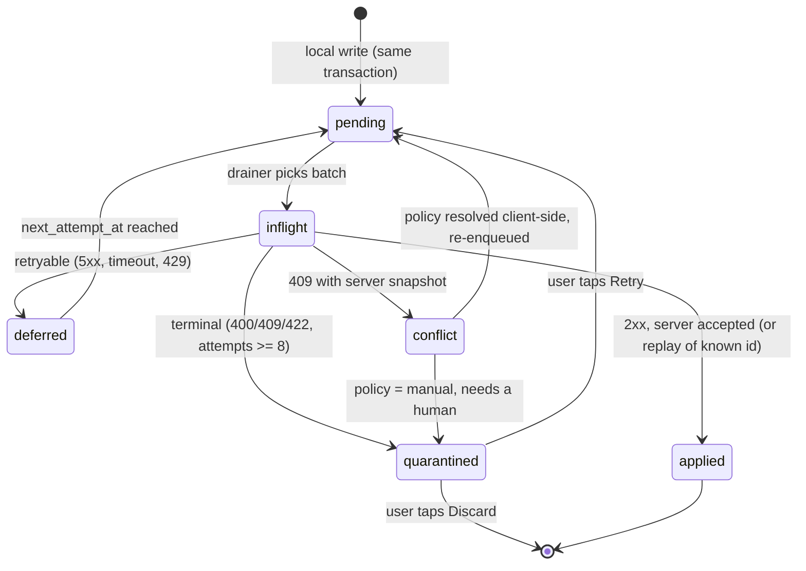

# Architecture

> Read this after `PRODUCT.md` and before `PLAN.md`.
> Vocabulary for modules and seams follows the codebase-design sense: a module presents one
> interface; the seam is where that interface lives; an adapter satisfies it.

---

## 1. One picture

```
┌────────────────────────────── apps/knockout-mobile (Expo, React Native) ─────────────────────────────┐
│                                                                                                      │
│  app/            expo-router screens (Shift, Map, Leads, Board, Settings, modals)                    │
│      │ uses                                                                                          │
│  src/features/   screen-level hooks + components (shift, knock, leads, board)                        │
│      │ uses                                                                                          │
│  src/data/       TanStack Query hooks  +  Zustand stores  +  SQLite DAOs                              │
│      │ depends on                                                                                    │
│  src/sync/       RUNTIME ADAPTERS: sqlite outbox store, supabase transport, expo-network,            │
│      │           app-state listener, background task, telemetry                                       │
│      │ implements the ports of                                                                       │
│  @gerardocordero/sync-core  ── pure TypeScript, zero React/RN imports ──▶ Vitest                     │
│                              engine · outbox ordering · backoff · policies · contract (Zod)           │
└──────────────────────────────────────────────┬───────────────────────────────────────────────────────┘
                                               │ HTTPS (anon key + user JWT)
                                               │ PostgREST reads · Edge Function writes
┌──────────────────────────────────────────────▼─────────────── supabase/ ────────────────────────────┐
│  migrations/*.sql   schema · indexes · triggers · server_seq · scoring function · RLS policies        │
│  functions/         sync-push (batch, idempotent, merge) · hubspot-sync (CRM outbox) · _shared/       │
│  tests/*.sql        pgTAP: RLS isolation matrix · scoring invariants                                  │
│  seed.sql           2 orgs · 2 teams · 8 reps · properties · knocks · leads                           │
└──────────────────────────────────────────────────────────────────────────────────────────────────────┘
                                               │
                                     HubSpot CRM API v3 (real | FakeHubSpot)
```

Two rules hold this shape together:

1. **`sync-core` knows nothing about React, Expo, or Supabase.** It receives ports. That is why its
   test suite is fast, deterministic, and the most valuable code in the repo.
2. **`src/sync/` is the only place that knows both worlds.** If Supabase changes, or SQLite is
   replaced, the blast radius is that directory.

---

## 2. Module map

| Module | Interface (what it promises) | Lives in | Adapters |
| --- | --- | --- | --- |
| `sync-core/engine` | `runDrain(ctx): DrainResult` — one bounded pass over the outbox | `packages/sync-core/src/engine.ts` | — (pure) |
| `sync-core/outbox` | `nextBatch`, `markInflight`, `markApplied`, `defer`, `quarantine` | `src/outbox.ts` | SQLite, in-memory |
| `sync-core/backoff` | `nextDelay(attempt, random): number` | `src/backoff.ts` | — (pure) |
| `sync-core/policies` | `resolve(local, remote, policy): Resolution` | `src/policies.ts` | — (pure) |
| `sync-core/contract` | Zod schemas + inferred wire types | `src/contract.ts` | — |
| `data/queries` | TanStack Query hooks: `useLeads`, `useBoard`, `useProperty` | `src/data/queries/` | PostgREST, SQLite |
| `data/stores` | Zustand slices: `session`, `shift`, `sync` | `src/data/stores/` | MMKV, SecureStore |
| `sync/transport` | `push(batch): PushResult`, `pull(cursor): PullResult` | `src/sync/transport.ts` | Supabase Edge Function, fake |
| `sync/runtime` | `start()`, `stop()`, `drainNow()`, `subscribe(status)` | `src/sync/runtime.ts` | expo-network, background task |
| `observability` | `captureError`, `addBreadcrumb`, `syncEvent` | `src/observability/` | Sentry, no-op |

Anything with two implementations gets a fake, and the fake is what tests use.

---

## 3. The write path (why nothing is lost)

```
tap "Appointment set"
  │
  ├─ 1. BEGIN TRANSACTION (expo-sqlite)
  │      insert into knocks (id, property_id, rep_id, outcome, occurred_at, …)
  │      insert into leads  (… )                      when outcome = 'set'
  │      insert into outbox (id = mutation_id, entity, entity_id, op, payload, state='pending')
  │    COMMIT
  │
  ├─ 2. queryClient.setQueryData(["knocks", today], prepend)   ← UI is already correct
  │
  ├─ 3. sync runtime notices queue_depth > 0
  │      offline ? pill = "Queued" and stop
  │      online  ? drain
  │
  └─ 4. drain: pending ▸ inflight ▸ applied | deferred | quarantined
```

Step 1 is the whole argument. Because the row and its mutation are written together, there is no
window where the UI shows a knock that the queue does not know about, and no window where the queue
has an intent whose data was lost.

---

## 4. Sync state machine



Rules the engine enforces:

- One batch per drain, ordered by `(created_at, id)`.
- On the **first non-retryable** failure the batch stops — later mutations may depend on it.
- A retryable failure defers that mutation and the batch stops (preserves order).
- A quarantined mutation is skipped, not stopping the batch: quarantine exists so one poison
  mutation cannot freeze a rep's day.
- The cursor from a push response is persisted before the next pull.

---

## 5. Conflict matrix

| Entity | Field group | Policy | Rationale |
| --- | --- | --- | --- |
| `properties` | address, geo, parcel | `server-wins` | Ops owns the canonical address. |
| `territories` | polygon, assignment | `server-wins` | A rep must not redraw their own zone. |
| `dnc_entries` | — | `server-wins` | Safety: never let a stale client resurrect a knocked property. |
| `knocks` | outcome, note, occurred_at | `client-wins` | Only the rep who was at the door knows. Append-only in practice. |
| `leads` | name, phone, email, appointment_at | `field-merge` (per-field LWW) | Two reps can edit different fields of the same lead. |
| `leads` | owner (`rep_id`) | `manual` | Reassignment is a business decision, never guessed. |
| `leads` | stage | `manual` when both changed since base; else LWW | Stage drives commission. |
| `daily_scores` | — | server-only | Never written by a client (ADR-0008). |
| `hubspot_links` | — | server-only | Idempotency lives server-side. |

A resolution that is not `client-wins` produces a `sync_conflicts` row with both snapshots; the
Sync screen lists it and, for `manual`, offers *Keep mine* / *Keep theirs*.

---

## 6. Data model (as built in `supabase/migrations`)

```
organizations ─┬─ teams ─┬─ members ── auth.users
               │         └─ territories ── territory_properties ── properties
               ├─ properties ─┬─ knocks ── (rep)
               │              ├─ leads ─┬─ appointments
               │              │         └─ hubspot_links
               │              └─ dnc_entries
               ├─ shifts ── (rep, territory)
               ├─ daily_scores ── (member, day)
               ├─ badges ── member_badges
               ├─ sync_mutations        (idempotency ledger)
               └─ crm_outbox            (CRM intentions)
```

Every tenant table carries `org_id` (denormalised on purpose: policies and indexes both need it
without a join). Every synced table carries `server_seq` and `updated_at`.

---

## 7. Error contract

Every Edge Function returns the same envelope. Clients branch on `kind`, never on prose.

```jsonc
// 4xx / 5xx
{ "error": { "kind": "retryable" | "terminal" | "conflict",
             "code": "RATE_LIMITED" | "VALIDATION" | "STALE_VERSION" | "UNKNOWN",
             "message": "human sentence",
             "details": { } } }
```

Mapping to the sync engine:

| HTTP | kind | Engine action |
| --- | --- | --- |
| 200/201 | — | `applied` |
| 409 with snapshot | `conflict` | resolve via policy or quarantine as `manual` |
| 422 / 400 | `terminal` | quarantine immediately |
| 429 / 5xx / timeout | `retryable` | defer with backoff |

---

## 8. Why not X

| Alternative | Why not, in one line |
| --- | --- |
| A custom Node API | The role's backend *is* Supabase; a bespoke API proves the wrong thing (ADR-0006). |
| WatermelonDB | Hides the sync semantics this project exists to demonstrate (ADR-0005). |
| Redux + Redux Persist | Server cache belongs in TanStack Query; the rest is three slices (ADR-0004). |
| GraphQL / tRPC | tRPC assumes a Node server we do not have; PostgREST already gives typed reads. |
| Detox | Needs a native test harness; Maestro is already proven here. Documented migration path below. |
| Full CRDT | Correct but baroque for five outcomes and a handful of fields (ADR-0007). |
| Background fetch that "just works" | The OS decides. Design for opportunistic, drain on foreground/reconnect. |

### Detox migration path (if the team standardises on it)

1. `npx expo prebuild` and keep the generated iOS/Android projects in CI.
2. Add `detox + @config-plugins/detox`, build a `debug` configuration once per platform.
3. Port the three Maestro flows 1:1 (`smoke`, `offline-knock`, `leaderboard`) — the selectors are
   already `testID`-based, which Detox accepts directly.
4. Keep Maestro for the *cloud* smoke job if a paid EAS plan exists; run Detox locally in CI.

---

## 9. Failure modes we designed for

| Failure | Expected behaviour |
| --- | --- |
| App killed mid-drain | Mutations stay `inflight`; on next boot they are reset to `pending` and replayed with the same idempotency key. |
| Server accepts, response lost | Replay returns the stored result; no duplicate lead. |
| Phone clock 3 hours fast | Cursor is a sequence, not a timestamp; ordering is server-side. |
| Two reps edit one lead | Per-field merge; owner change becomes a `manual` conflict. |
| One poison mutation | Quarantined; the rest of the queue keeps flowing. |
| Phone in a basement for an hour | Retries back off to 60 s; on reconnect the drain resumes in order. |
| Token expired while offline | Push returns 401 → runtime refreshes once, then pauses the queue and shows *Sign in again*. |
| Postgres policy too loose | pgTAP isolation matrix fails the build. |

---

## 10. Observability

| Signal | Where | Why it exists |
| --- | --- | --- |
| `queue_depth` | Sync screen + telemetry | The only early warning that sync is stuck. |
| `last_success_at` | Header pill | "Synced 12 min ago" is a different problem from "never synced". |
| per-mutation `attempt`, `last_error` | Sync screen | Turns a support ticket into a diagnosis. |
| `sync.conflict` events | Sentry breadcrumbs | Conflicts are a product smell, not just an error. |
| `release`, `runtime_version` | Sentry tags | An OTA that breaks one native build is invisible without this. |

No PII in telemetry: lead names, phones, emails, and photo paths are scrubbed before the event
leaves the device.
